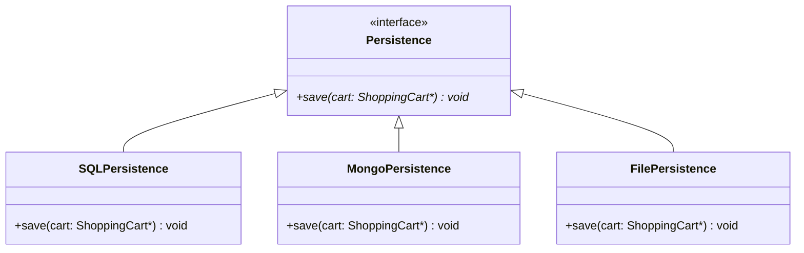
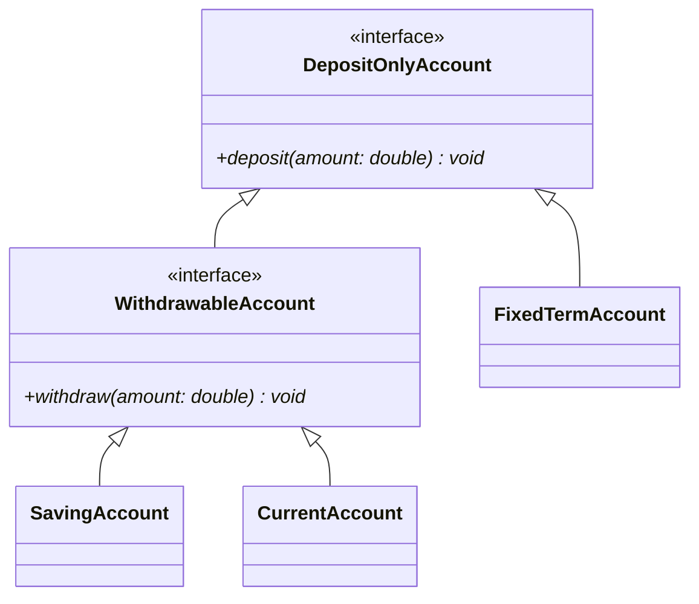

# SOLID Design Principles — Revision Guide (SRP, OCP, LSP)

> **SOLID** is an acronym for five foundational design principles for writing maintainable, scalable, understandable, and robust Object-Oriented software.

---

## 📑 Quick Overview

| Principle | Name | Core Idea | In One Sentence |
|:---:|---|---|---|
| **S** | **Single Responsibility Principle (SRP)** | One class, one job | *"A class should have one, and only one, reason to change."* |
| **O** | **Open/Closed Principle (OCP)** | Extend, don't modify | *"Open for extension, closed for modification."* |
| **L** | **Liskov Substitution Principle (LSP)** | Subtypes must be substitutable | *"Derived classes must be substitutable for their base classes without breaking behavior."* |
| **I** | Interface Segregation Principle (ISP) | Fine-grained interfaces | Clients should not be forced to depend on interfaces they do not use. |
| **D** | Dependency Inversion Principle (DIP) | Depend on abstractions | High-level modules should depend on abstractions, not concrete details. |

---

## 1. Single Responsibility Principle (SRP)

> **"A class should have only one reason to change."** — Robert C. Martin

Every class, module, or function should focus strictly on **one single responsibility or concern**.

### ❌ The Violation (`SRP_violated.cpp`)
In [`SRP_violated.cpp`](file:///home/nitin/Desktop/LLD/2_SOLID/SRP/SRP_violated.cpp), `ShoppingCart` was handling three unrelated concerns:
1. **Cart Business Logic:** Adding items and calculating the total.
2. **Presentation Logic:** Formatting and printing invoices to the console (`printInvoice()`).
3. **Persistence Logic:** Saving cart data to a database (`saveToDatabase()`).

**Why this is dangerous:**
* If the receipt layout changes, `ShoppingCart` must be modified.
* If the database schema changes, `ShoppingCart` must be modified.
* Multiple unrelated reasons to change lead to high coupling, difficult testing, and frequent merge conflicts.

```cpp
// ❌ VIOLATION: ShoppingCart does everything
class ShoppingCart {
    vector<Product*> products;
public:
    void addProduct(Product* p);
    double calculateTotal();
    void printInvoice();    // ❌ Belongs to presentation
    void saveToDatabase();  // ❌ Belongs to persistence
};
```

### ✅ The Solution (`SRP_followed.cpp`)
In [`SRP_followed.cpp`](file:///home/nitin/Desktop/LLD/2_SOLID/SRP/SRP_followed.cpp), responsibilities are split into dedicated classes:

1. **`ShoppingCart`:** Responsible solely for items and calculation.
2. **`ShoppingCartPrinter`:** Responsible solely for formatting & displaying invoice.
3. **`ShoppingCartStorage`:** Responsible solely for saving data.

```cpp
// ✅ FOLLOWED: Each class has a single, well-defined job
class ShoppingCart {
    vector<Product*> products;
public:
    void addProduct(Product* p) { products.push_back(p); }
    double calculateTotal() { /* ... */ }
    const vector<Product*>& getProducts() { return products; }
};

class ShoppingCartPrinter {
    ShoppingCart* cart;
public:
    ShoppingCartPrinter(ShoppingCart* cart) : cart(cart) {}
    void printInvoice() { /* prints cart items & total */ }
};

class ShoppingCartStorage {
    ShoppingCart* cart;
public:
    ShoppingCartStorage(ShoppingCart* cart) : cart(cart) {}
    void saveToDatabase() { /* persists cart */ }
};
```

---

## 2. Open/Closed Principle (OCP)

> **"Software entities (classes, modules, functions) should be open for extension, but closed for modification."** — Bertrand Meyer

You should be able to introduce **new functionality** without altering existing, tested code.

### ❌ The Violation (`OCP_violated.cpp`)
In [`OCP_violated.cpp`](file:///home/nitin/Desktop/LLD/2_SOLID/OCP/OCP_violated.cpp), `ShoppingCartStorage` hardcoded individual methods for every storage medium:

```cpp
// ❌ VIOLATION: Every new storage type requires editing this class
class ShoppingCartStorage {
public:
    void saveToSQLDatabase() { /* ... */ }
    void saveToMongoDatabase() { /* ... */ }
    void saveToFile() { /* ... */ }
    // Adding Redis? You MUST modify ShoppingCartStorage!
};
```

**Why this is dangerous:**
* Whenever a new database is required (e.g., Redis, Cloud Bucket, Cassandra), you must **modify** `ShoppingCartStorage`.
* Modifying existing code introduces regression risks to features already working in production.

### ✅ The Solution (`OCP_followed.cpp`)
In [`OCP_followed.cpp`](file:///home/nitin/Desktop/LLD/2_SOLID/OCP/OCP_followed.cpp), we introduce an **abstract interface** (`Persistence`):



```cpp
// ✅ Abstract base class (closed for modification)
class Persistence {
public:
    virtual void save(ShoppingCart* cart) = 0;
    virtual ~Persistence() = default;
};

// ✅ Concrete extensions (open for extension)
class SQLPersistence : public Persistence {
public:
    void save(ShoppingCart* cart) override {
        cout << "Saving to SQL DB...\n";
    }
};

class MongoPersistence : public Persistence {
public:
    void save(ShoppingCart* cart) override {
        cout << "Saving to MongoDB...\n";
    }
};

// Adding Redis? Just add a new class — ZERO changes to existing code!
class RedisPersistence : public Persistence {
public:
    void save(ShoppingCart* cart) override {
        cout << "Saving to Redis Cache...\n";
    }
};
```

---

## 3. Liskov Substitution Principle (LSP)

> **"If $S$ is a subtype of $T$, then objects of type $T$ may be replaced with objects of type $S$ without altering any of the desirable properties of the program."** — Barbara Liskov

A derived class must **honor the contract** of its base class. A client using a base class pointer or reference should never experience unexpected runtime exceptions or degraded behavior when passed a derived class.

### ❌ The Violation (`LSP_violated.cpp`)
In [`LSP_violated.cpp`](file:///home/nitin/Desktop/LLD/2_SOLID/LSP/LSP_violated.cpp), the base `Account` forced a `withdraw()` method on all accounts:

```cpp
// ❌ Base contract assumes every account can withdraw
class Account {
public:
    virtual void deposit(double amount) = 0;
    virtual void withdraw(double amount) = 0;
};
```

* `FixedTermAccount` (e.g., Fixed Deposit / Certificate of Deposit) **cannot** allow withdrawals until maturity.
* As a workaround, `FixedTermAccount` threw a runtime exception:
  ```cpp
  void withdraw(double amount) override {
      throw logic_error("Withdrawal not allowed in Fixed Term Account!");
  }
  ```
* When `BankClient` iterates over `vector<Account*>` and calls `acc->withdraw()`, the program crashes at runtime! The child class cannot safely substitute the parent.

### ✅ The Solution (`LSP_followed.cpp`)
In [`LSP_followed.cpp`](file:///home/nitin/Desktop/LLD/2_SOLID/LSP/LSP_followed.cpp), we redesign the hierarchy so that **interfaces match actual capabilities**:



```cpp
// 1. Base abstraction: Every account supports deposits
class DepositOnlyAccount {
public:
    virtual void deposit(double amount) = 0;
    virtual ~DepositOnlyAccount() = default;
};

// 2. Specialized abstraction: Only accounts that allow withdrawal
class WithdrawableAccount : public DepositOnlyAccount {
public:
    virtual void withdraw(double amount) = 0;
};

// 3. Concrete classes inherit ONLY what they legitimately support:
class SavingAccount : public WithdrawableAccount { /* deposit & withdraw */ };
class CurrentAccount : public WithdrawableAccount { /* deposit & withdraw */ };
class FixedTermAccount : public DepositOnlyAccount { /* deposit ONLY */ };
```

Now, functions that process withdrawals accept `WithdrawableAccount*`, guaranteeing at **compile time** that no runtime surprise or invalid withdrawal will ever occur!

---

## 💡 C++ Best Practice Highlight: Stack Allocation & RAII

Throughout modern C++ and Low-Level Design:
* Prefer **stack allocation** (`ShoppingCart cart;`) over bare heap allocation (`ShoppingCart* cart = new ShoppingCart();`).
* Stack objects are cleaned up automatically when they leave scope (RAII), preventing memory leaks without needing manual `delete`.
* Use the **dot operator (`.`)** for direct objects and pass by pointer (`&obj`) or reference (`Type&`) when sharing across classes:

```cpp
int main() {
    SavingAccount saving;
    CurrentAccount current;
    FixedTermAccount fixedTerm;

    // 1. All accounts can deposit
    vector<DepositOnlyAccount*> allAccounts = { &saving, &current, &fixedTerm };
    for (DepositOnlyAccount* acc : allAccounts) {
        acc->deposit(1000);
    }

    // 2. Only withdrawable accounts can withdraw (compile-time safety!)
    vector<WithdrawableAccount*> withdrawableAccounts = { &saving, &current };
    for (WithdrawableAccount* acc : withdrawableAccounts) {
        processWithdrawal(acc, 500);
    }

    return 0;
}
```

---

## 🎯 Summary Comparison

| Concept | The "Bad" Smell (Violation) | The "Good" Design (Followed) |
|---|---|---|
| **SRP** | "God" class doing business logic, UI, and DB calls. | Small, cohesive classes each doing one thing well. |
| **OCP** | `switch`/`if-else` or multiple methods (`saveSQL`, `saveMongo`) in one class. | Polymorphic interfaces (`Persistence`) extended by new classes. |
| **LSP** | Child class throws `NotSupportedException` or leaves base methods empty. | Split hierarchies so subclasses actually fulfill all parent contracts. |

