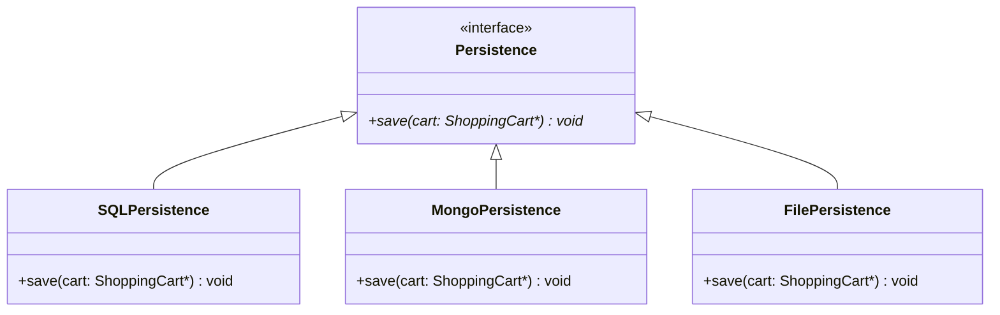
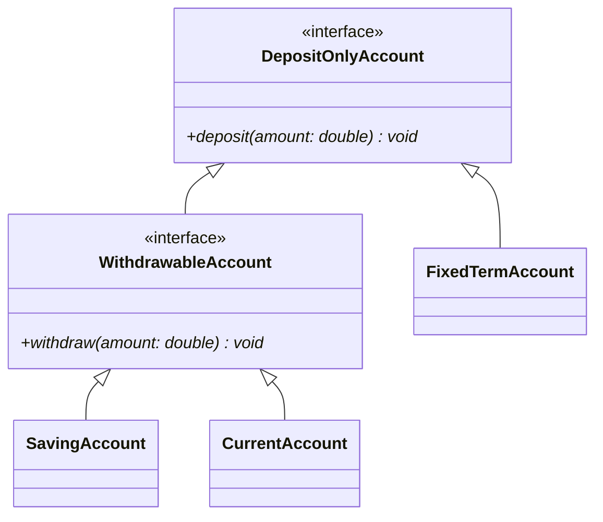
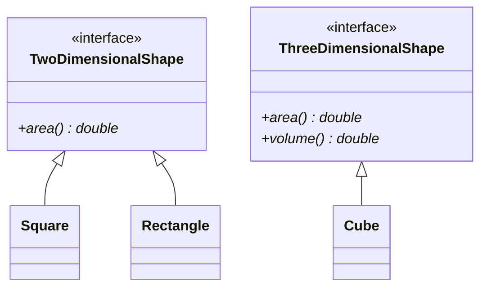
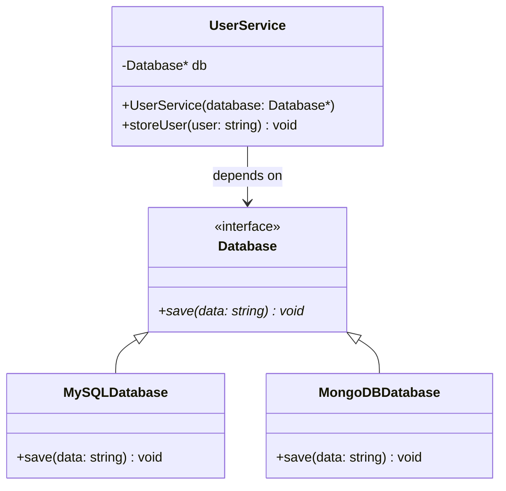

# SOLID Design Principles — Revision Guide (SRP, OCP, LSP, ISP, DIP)

> **SOLID** is an acronym for five foundational design principles for writing maintainable, scalable, understandable, and robust Object-Oriented software.

---

## 📑 Quick Overview

| Principle | Name | Core Idea | In One Sentence |
|:---:|---|---|---|
| **S** | **Single Responsibility Principle (SRP)** | One class, one job | *"A class should have one, and only one, reason to change."* |
| **O** | **Open/Closed Principle (OCP)** | Extend, don't modify | *"Open for extension, closed for modification."* |
| **L** | **Liskov Substitution Principle (LSP)** | Subtypes must be substitutable | *"Derived classes must be substitutable for their base classes without breaking behavior."* |
| **I** | Interface Segregation Principle (ISP) | Fine-grained interfaces | Clients should not be forced to depend on interfaces they do not use. |
| **D** | Dependency Inversion Principle (DIP) | Depend on abstractions | High-level modules should depend on abstractions, not concrete details. |

---

## 1. Single Responsibility Principle (SRP)

> **"A class should have only one reason to change."** — Robert C. Martin

Every class, module, or function should focus strictly on **one single responsibility or concern**.

### ❌ The Violation (`SRP_violated.cpp`)
In [`SRP_violated.cpp`](file:///home/nitin/Desktop/LLD/2_SOLID/SRP/SRP_violated.cpp), `ShoppingCart` was handling three unrelated concerns:
1. **Cart Business Logic:** Adding items and calculating the total.
2. **Presentation Logic:** Formatting and printing invoices to the console (`printInvoice()`).
3. **Persistence Logic:** Saving cart data to a database (`saveToDatabase()`).

**Why this is dangerous:**
* If the receipt layout changes, `ShoppingCart` must be modified.
* If the database schema changes, `ShoppingCart` must be modified.
* Multiple unrelated reasons to change lead to high coupling, difficult testing, and frequent merge conflicts.

```cpp
// ❌ VIOLATION: ShoppingCart does everything
class ShoppingCart {
    vector<Product> products;
public:
    void addProduct(const Product& p);
    double calculateTotal() const;
    void printInvoice() const;    // ❌ Belongs to presentation
    void saveToDatabase() const;  // ❌ Belongs to persistence
};
```

### ✅ The Solution (`SRP_followed.cpp`)
In [`SRP_followed.cpp`](file:///home/nitin/Desktop/LLD/2_SOLID/SRP/SRP_followed.cpp), responsibilities are split into dedicated classes:

1. **`ShoppingCart`:** Responsible solely for items and calculation.
2. **`ShoppingCartPrinter`:** Responsible solely for formatting & displaying invoice.
3. **`ShoppingCartStorage`:** Responsible solely for saving data.

```cpp
// ✅ FOLLOWED: Each class has a single, well-defined job
class ShoppingCart {
    vector<Product> products;
public:
    void addProduct(const Product& p) { products.push_back(p); }
    double calculateTotal() const { /* ... */ }
    const vector<Product>& getProducts() const { return products; }
};

class ShoppingCartPrinter {
    const ShoppingCart& cart; // Holds reference (no pointers)
public:
    ShoppingCartPrinter(const ShoppingCart& cart) : cart(cart) {}
    void printInvoice() const { /* prints cart items & total */ }
};

class ShoppingCartStorage {
    const ShoppingCart& cart; // Holds reference (no pointers)
public:
    ShoppingCartStorage(const ShoppingCart& cart) : cart(cart) {}
    void saveToDatabase() const { /* persists cart */ }
};
```

---

## 2. Open/Closed Principle (OCP)

> **"Software entities (classes, modules, functions) should be open for extension, but closed for modification."** — Bertrand Meyer

You should be able to introduce **new functionality** without altering existing, tested code.

### ❌ The Violation (`OCP_violated.cpp`)
In [`OCP_violated.cpp`](file:///home/nitin/Desktop/LLD/2_SOLID/OCP/OCP_violated.cpp), `ShoppingCartStorage` hardcoded individual methods for every storage medium:

```cpp
// ❌ VIOLATION: Every new storage type requires editing this class
class ShoppingCartStorage {
public:
    void saveToSQLDatabase() { /* ... */ }
    void saveToMongoDatabase() { /* ... */ }
    void saveToFile() { /* ... */ }
    // Adding Redis? You MUST modify ShoppingCartStorage!
};
```

**Why this is dangerous:**
* Whenever a new database is required (e.g., Redis, Cloud Bucket, Cassandra), you must **modify** `ShoppingCartStorage`.
* Modifying existing code introduces regression risks to features already working in production.

### ✅ The Solution (`OCP_followed.cpp`)
In [`OCP_followed.cpp`](file:///home/nitin/Desktop/LLD/2_SOLID/OCP/OCP_followed.cpp), we introduce an **abstract interface** (`Persistence`):



```cpp
// ✅ Abstract base class (closed for modification)
class Persistence {
public:
    virtual void save(ShoppingCart* cart) = 0;
    virtual ~Persistence() = default;
};

// ✅ Concrete extensions (open for extension)
class SQLPersistence : public Persistence {
public:
    void save(ShoppingCart* cart) override {
        cout << "Saving to SQL DB...\n";
    }
};

class MongoPersistence : public Persistence {
public:
    void save(ShoppingCart* cart) override {
        cout << "Saving to MongoDB...\n";
    }
};

// Adding Redis? Just add a new class — ZERO changes to existing code!
class RedisPersistence : public Persistence {
public:
    void save(ShoppingCart* cart) override {
        cout << "Saving to Redis Cache...\n";
    }
};
```

---

## 3. Liskov Substitution Principle (LSP)

> **"If $S$ is a subtype of $T$, then objects of type $T$ may be replaced with objects of type $S$ without altering any of the desirable properties of the program."** — Barbara Liskov

A derived class must **honor the contract** of its base class. A client using a base class pointer or reference should never experience unexpected runtime exceptions or degraded behavior when passed a derived class.

### ❌ The Violation (`LSP_violated.cpp`)
In [`LSP_violated.cpp`](file:///home/nitin/Desktop/LLD/2_SOLID/LSP/LSP_violated.cpp), the base `Account` forced a `withdraw()` method on all accounts:

```cpp
// ❌ Base contract assumes every account can withdraw
class Account {
public:
    virtual void deposit(double amount) = 0;
    virtual void withdraw(double amount) = 0;
};
```

* `FixedTermAccount` (e.g., Fixed Deposit / Certificate of Deposit) **cannot** allow withdrawals until maturity.
* As a workaround, `FixedTermAccount` threw a runtime exception:
  ```cpp
  void withdraw(double amount) override {
      throw logic_error("Withdrawal not allowed in Fixed Term Account!");
  }
  ```
* When `BankClient` iterates over `vector<Account*>` and calls `acc->withdraw()`, the program crashes at runtime! The child class cannot safely substitute the parent.

### ✅ The Solution (`LSP_followed.cpp`)
In [`LSP_followed.cpp`](file:///home/nitin/Desktop/LLD/2_SOLID/LSP/LSP_followed.cpp), we redesign the hierarchy so that **interfaces match actual capabilities**:



```cpp
// 1. Base abstraction: Every account supports deposits
class DepositOnlyAccount {
public:
    virtual void deposit(double amount) = 0;
    virtual ~DepositOnlyAccount() = default;
};

// 2. Specialized abstraction: Only accounts that allow withdrawal
class WithdrawableAccount : public DepositOnlyAccount {
public:
    virtual void withdraw(double amount) = 0;
};

// 3. Concrete classes inherit ONLY what they legitimately support:
class SavingAccount : public WithdrawableAccount { /* deposit & withdraw */ };
class CurrentAccount : public WithdrawableAccount { /* deposit & withdraw */ };
class FixedTermAccount : public DepositOnlyAccount { /* deposit ONLY */ };
```

Now, functions that process withdrawals accept `WithdrawableAccount&`, guaranteeing at **compile time** that no runtime surprise or invalid withdrawal will ever occur:

```cpp
void makeWithdrawal(WithdrawableAccount& acc, double amount) {
    acc.withdraw(amount);
}

int main() {
    SavingAccount saving;
    CurrentAccount current;
    FixedTermAccount fixedTerm;

    // 1. All accounts can deposit
    vector<DepositOnlyAccount*> accounts = { &saving, &current, &fixedTerm };
    for (auto acc : accounts) {
        acc->deposit(1000);
    }

    // 2. Only withdrawable accounts can withdraw
    makeWithdrawal(saving, 500);
    makeWithdrawal(current, 500);

    // makeWithdrawal(fixedTerm, 500); // ❌ Compile-time error! (Prevents runtime bugs)

    return 0;
}
```

---

## 4. Interface Segregation Principle (ISP)

> **"Clients should not be forced to depend on interfaces they do not use."** — Robert C. Martin

Prefer many small, role-specific interfaces over one large "fat" interface.

### ❌ The Violation (`ISP_violated.cpp`)
In [`ISP_violated.cpp`](file:///home/nitin/Desktop/LLD/2_SOLID/ISP/ISP_violated.cpp), a single fat `Shape` interface forces **all** shapes — 2D and 3D — to implement both `area()` and `volume()`:

```cpp
// ❌ VIOLATION: Fat interface forces 2D shapes to implement volume()
class Shape {
public:
    virtual double area() = 0;
    virtual double volume() = 0;   // Meaningless for 2D shapes!
};

class Square : public Shape {
    double area() override { return side * side; }
    double volume() override {
        throw logic_error("Square has no volume!"); // ❌ Forced stub
    }
};
```

**Why this is dangerous:**
* 2D shapes like `Square` and `Rectangle` must implement a `volume()` they can never fulfill.
* Calling `volume()` on a 2D shape causes a **runtime crash**.
* Violates LSP as well — a `Square*` can't safely substitute a `Shape*` for volume operations.

### ✅ The Solution (`ISP_followed.cpp`)
In [`ISP_followed.cpp`](file:///home/nitin/Desktop/LLD/2_SOLID/ISP/ISP_followed.cpp), the fat interface is **split** into two focused interfaces:



```cpp
// ✅ FOLLOWED: Segregated interfaces matching actual capabilities
class TwoDimensionalShape {
public:
    virtual double area() = 0;
    virtual ~TwoDimensionalShape() = default;
};

class ThreeDimensionalShape {
public:
    virtual double area() = 0;
    virtual double volume() = 0;
    virtual ~ThreeDimensionalShape() = default;
};

class Square : public TwoDimensionalShape { /* area() only */ };
class Rectangle : public TwoDimensionalShape { /* area() only */ };
class Cube : public ThreeDimensionalShape { /* area() + volume() */ };
```

---

## 5. Dependency Inversion Principle (DIP)

> **"High-level modules should not depend on low-level modules. Both should depend on abstractions."** — Robert C. Martin

Depend on **abstractions** (interfaces/abstract classes), not on **concrete implementations**.

### ❌ The Violation (`DIP_violated.cpp`)
In [`DIP_violated.cpp`](file:///home/nitin/Desktop/LLD/2_SOLID/DIP/DIP_violated.cpp), the high-level `UserService` directly depends on concrete low-level database classes:

```cpp
// ❌ VIOLATION: High-level module tightly coupled to concrete implementations
class UserService {
private:
    MySQLDatabase sqlDb;       // ❌ Direct dependency on concretion
    MongoDBDatabase mongoDb;   // ❌ Direct dependency on concretion
public:
    void storeUserToSQL(string user) { sqlDb.saveToSQL(user); }
    void storeUserToMongo(string user) { mongoDb.saveToMongo(user); }
    // Adding Redis? Must modify UserService!
};
```

**Why this is dangerous:**
* Adding a new database forces modifications to `UserService` — violates OCP too.
* High-level business policy is tightly coupled to low-level storage details.
* Unit testing `UserService` requires real database instances.

### ✅ The Solution (`DIP_followed.cpp`)
In [`DIP_followed.cpp`](file:///home/nitin/Desktop/LLD/2_SOLID/DIP/DIP_followed.cpp), an abstract `Database` interface is introduced, and dependencies are **injected** via constructor:



```cpp
// ✅ Abstraction both modules depend on
class Database {
public:
    virtual void save(string data) = 0;
    virtual ~Database() = default;
};

class MySQLDatabase : public Database {
    void save(string data) override { cout << "Saving to MySQL...\n"; }
};

class MongoDBDatabase : public Database {
    void save(string data) override { cout << "Saving to MongoDB...\n"; }
};

// ✅ High-level module depends only on abstraction
class UserService {
private:
    Database* db;  // Abstraction, not concretion
public:
    UserService(Database* database) : db(database) {}
    void storeUser(string user) { db->save(user); }
};
```

---

## 6. LSP Rules — Deep Dive (`LSP-Rules/`)

The Liskov Substitution Principle is governed by **three categories of rules** that a subtype must respect:

### 📐 Signature Rules

| Rule | File | What It Means |
|---|---|---|
| **Return Type Covariance** | [`ReturnTypeRule.cpp`](file:///home/nitin/Desktop/LLD/2_SOLID/LSP-Rules/SingatureRules/ReturnTypeRule.cpp) | Overridden methods must return the **same or narrower** (more derived) type. E.g., parent returns `Animal*`, child returns `Dog*`. |
| **Method Argument Rule** | [`MethodArgumentRule.cpp`](file:///home/nitin/Desktop/LLD/2_SOLID/LSP-Rules/SingatureRules/MethodArgumentRule.cpp) | Overridden methods must accept the **same or wider** (more general) argument types. C++ enforces identical signatures. |
| **Exception Rule** | [`ExceptionRule.cpp`](file:///home/nitin/Desktop/LLD/2_SOLID/LSP-Rules/SingatureRules/ExceptionRule.cpp) | A subclass should throw **fewer or narrower** exceptions — never broader. E.g., if parent throws `logic_error`, child may throw `out_of_range` (a subtype), but not `runtime_error`. |

### ⚙️ Method Rules

| Rule | File | What It Means |
|---|---|---|
| **Precondition Weakening** | [`PreConditions.cpp`](file:///home/nitin/Desktop/LLD/2_SOLID/LSP-Rules/MethodRules/PreConditions.cpp) | A subclass may **relax** (weaken) preconditions but must never **strengthen** them. E.g., parent requires password ≥ 8 chars; child accepts ≥ 6 chars. |
| **Postcondition Strengthening** | [`PostConditions.cpp`](file:///home/nitin/Desktop/LLD/2_SOLID/LSP-Rules/MethodRules/PostConditions.cpp) | A subclass may **strengthen** (add more guarantees to) postconditions but must never **weaken** them. E.g., `HybridCar::brake()` guarantees speed decreases *and* charge increases. |

### 🏛️ Properties Rules

| Rule | File | What It Means |
|---|---|---|
| **Class Invariant Preservation** | [`ClassInvariants.cpp`](file:///home/nitin/Desktop/LLD/2_SOLID/LSP-Rules/PropertiesRules/ClassInvariants.cpp) | A subclass must **maintain** the parent's invariants. E.g., if `BankAccount` guarantees balance ≥ 0, a subclass must not allow negative balance. |
| **History Constraint** | [`HistoryConstraint.cpp`](file:///home/nitin/Desktop/LLD/2_SOLID/LSP-Rules/PropertiesRules/HistoryConstraint.cpp) | A subclass must not **disallow state transitions** the parent allowed. E.g., if parent supports `withdraw()`, child must not throw on it. |

---

## 🎯 Summary Comparison

| Concept | The "Bad" Smell (Violation) | The "Good" Design (Followed) |
|---|---|---|
| **SRP** | "God" class doing business logic, UI, and DB calls. | Small, cohesive classes each doing one thing well. |
| **OCP** | `switch`/`if-else` or multiple methods (`saveSQL`, `saveMongo`) in one class. | Polymorphic interfaces (`Persistence`) extended by new classes. |
| **LSP** | Child class throws `NotSupportedException` or leaves base methods empty. | Split hierarchies so subclasses actually fulfill all parent contracts. |
| **ISP** | Fat interface forces classes to implement methods they can't use. | Small, role-specific interfaces matching actual capabilities. |
| **DIP** | High-level module directly instantiates and calls low-level concrete classes. | Both depend on an abstract interface; dependencies are injected. |

